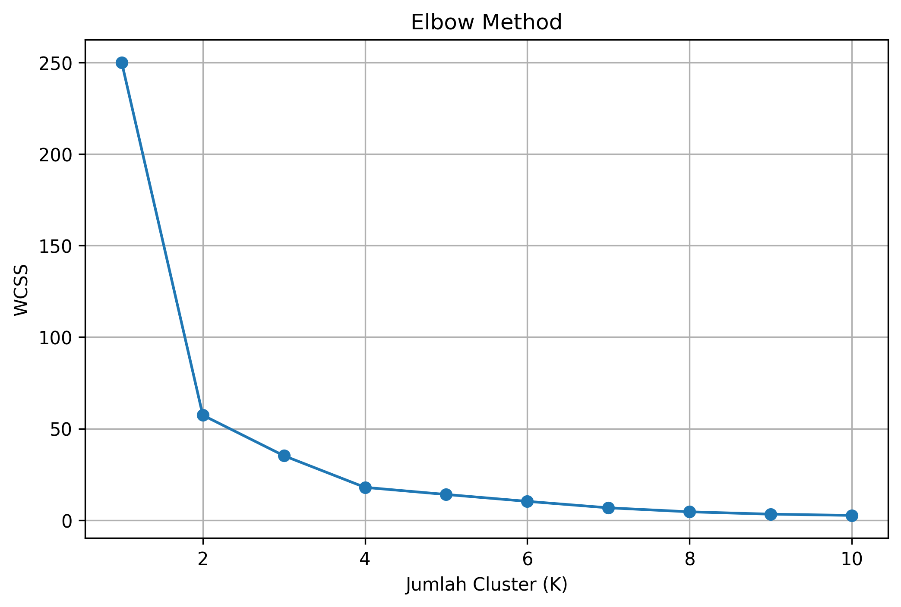
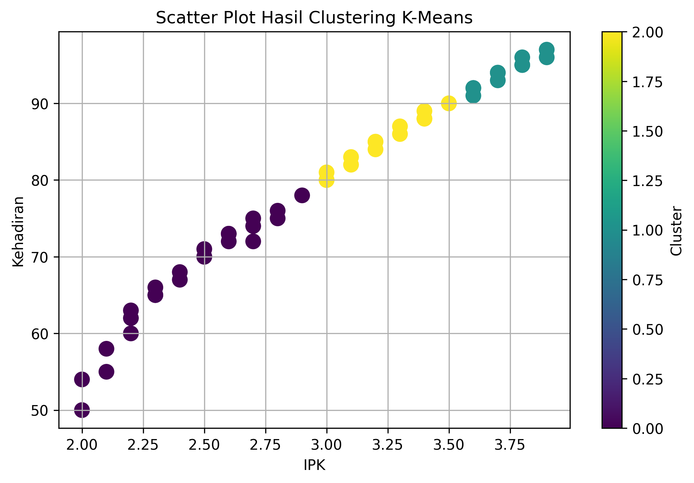
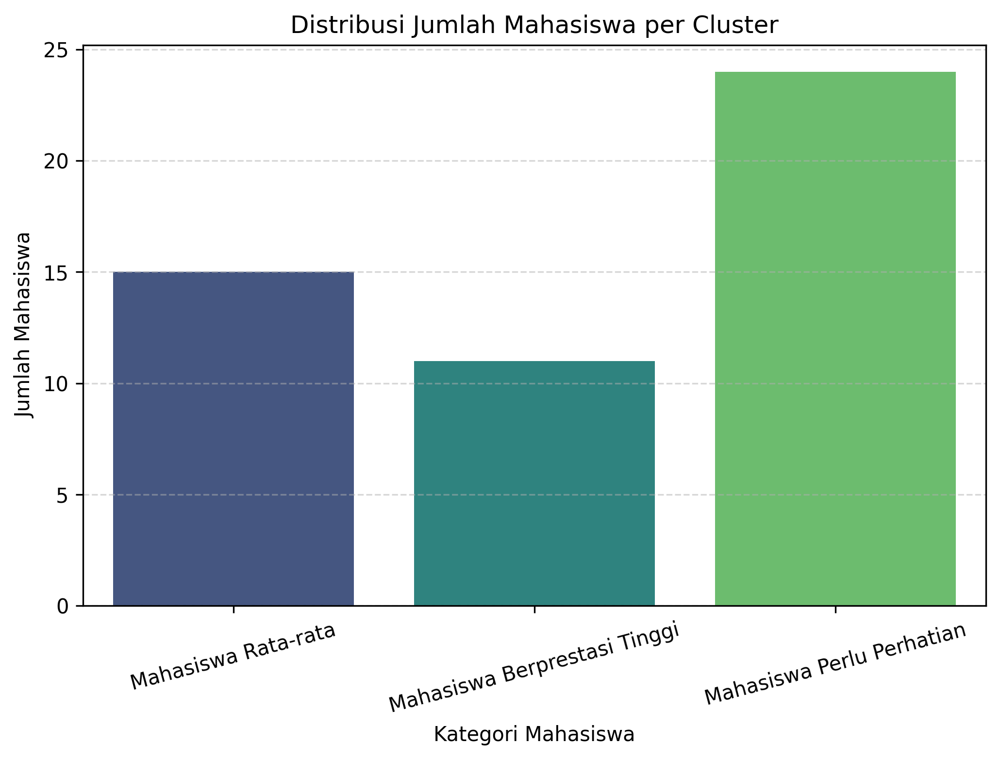

# Student Performance Clustering

A student performance analysis project using **K-Means Clustering** to group students based on academic performance, attendance, study habits, and organizational participation.

## Overview

This project applies the K-Means algorithm to identify student performance patterns and divide students into three different categories.

The clustering process uses five academic and behavioral attributes to analyze similarities between students.

## Features

- Data preprocessing using StandardScaler.
- Student grouping using K-Means Clustering.
- Determining the optimal number of clusters using the Elbow Method.
- Visualizing clustering results using Scatter Plot.
- Evaluating clustering quality using Silhouette Score.
- Displaying student distribution across clusters.
- Exporting clustering results into CSV format.

## Dataset

The dataset contains the following attributes:

| Attribute | Description |
|---|---|
| IPK | Grade Point Average |
| Kehadiran | Student attendance |
| Tugas | Assignment score |
| JamBelajar | Study hours |
| Organisasi | Organizational participation |

## Clustering Categories

The project divides students into three categories based on their cluster centroid IPK:

| Cluster | Category |
|---|---|
| 0 | Mahasiswa Berprestasi Tinggi |
| 1 | Mahasiswa Rata-rata |
| 2 | Mahasiswa Perlu Perhatian |

## Technologies

- Python
- Pandas
- NumPy
- Scikit-learn
- Matplotlib
- Seaborn
- Google Colab

## Project Structure

```text
student-performance-clustering/
├── README.md
├── clustering.py
├── requirements.txt
├── Soal latihan pertemuan 11 - Sheet1.csv
└── outputs/
    ├── elbow-method.png
    ├── scatter-plot.png
    ├── cluster-distribution.png
    ├── silhouette-score.txt
    └── hasil-kmeans-mahasiswa.csv
```

## Results & Visualization

### 1. Elbow Method


### 2. Scatter Plot


### 3. Cluster Distribution


### 4. Silhouette Score

The Silhouette Score is used to evaluate how well the data points fit within their assigned clusters.

See the result in `outputs/silhouette-score.txt`.

## Installation & Usage

Install the required libraries:

```bash
pip install -r requirements.txt
```

Run the Python script:

```bash
python clustering.py
```

## Output

The clustering results are exported into:

- `Hasil_KMeans_Mahasiswa.csv`
- `outputs/hasil-kmeans-mahasiswa.csv`
- Visualization images
- Silhouette Score report

---

**Project Focus:** Data Mining | Unsupervised Learning | K-Means Clustering
